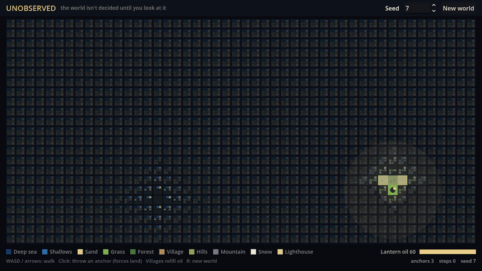
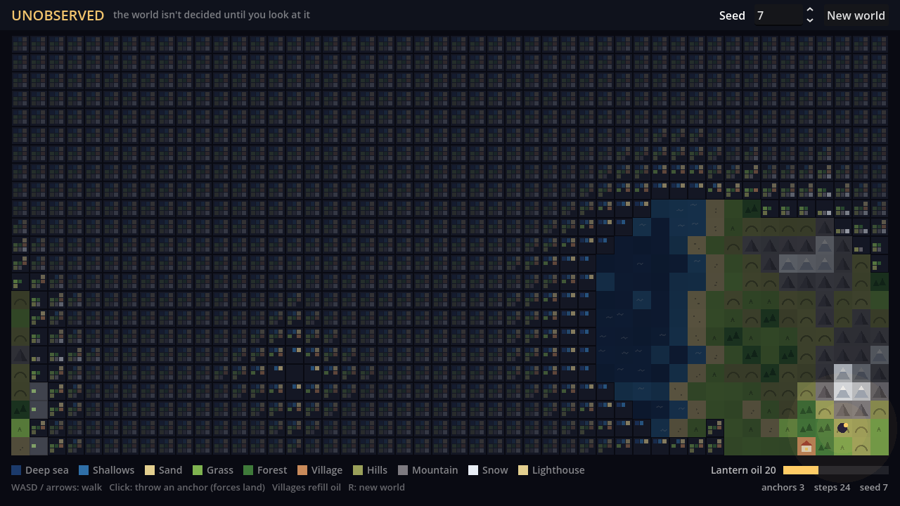
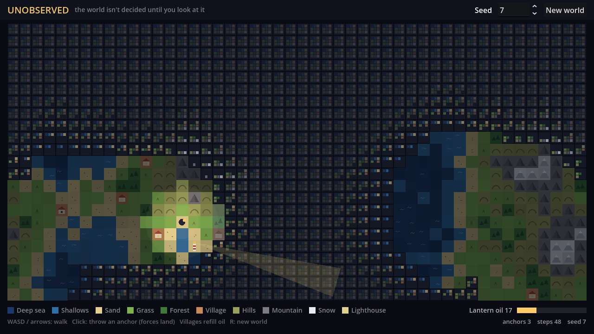

# Unobserved: Technical Commentary

*A small exploration game where the world isn't decided until you look at it. Built in Godot 4.7 with plain GDScript: no plugins, no image files, no audio files.*

## The idea

The algorithm's name comes from quantum mechanics, where a system stays in a superposition of states until it's observed. Most WFC generators treat that as a metaphor and generate the whole level up front. **Unobserved** makes it literal: the solver only observes cells inside the player's lantern light, so exploring *is* generating. The goal is to find a lighthouse on a distant coast before your oil runs out.

## How it works

**Wave Function Collapse ([`scripts/wfc.gd`](scripts/wfc.gd)).** The map is a 48×23 grid using the *simple tiled model*, with ten tiles: deep sea, shallows, sand, grass, forest, village, hills, mountain, snow and lighthouse. Each cell's superposition is a 10-bit mask. Each frame, the solver:

1. **Observes** the lowest-entropy cell, but only within the lantern radius.
2. **Collapses** it to a weighted-random tile.
3. **Propagates**: each neighbour's mask is ANDed with the set of tiles allowed next to it, and this repeats until nothing changes (arc consistency).

The rules form an elevation ladder (deep → shallows → sand → grass → hills → mountain → snow), with forests and villages branching off grass. Because a mask has only 2¹⁰ possible values, each mask's compatible-neighbour mask and Shannon entropy are precomputed. Propagation is one bitwise AND, and choosing a cell is a table lookup.

**Information leaks into the fog.** Propagation isn't limited to the light. The lighthouse is *pinned* to a distant coast before anything is observed, so its constraints spread outward: cells around it lose options and their swatches thin out. Unobserved cells draw a 3×3 swatch of every tile they could still become, so an observant player can read the fog. Fewer options means something certain is nearby.

**Anchors bend reality.** Clicking pins a cell to grass. The solver un-collapses the surrounding area and re-derives every superposition. If the anchor lands in the sea, land has to grow around it to satisfy the rules, so anchors become bridges. The same repair handles rare contradictions: instead of restarting, the solver un-collapses a growing radius until the grid is solvable. The tile under the player is always locked, so the world can't change beneath your feet.

**Noise-guided weights.** Pure WFC produces locally valid but noisy maps. Each tile's weight is multiplied by a Gaussian of how far its elevation is from a `FastNoiseLite` height field. WFC guarantees *local* correctness while noise gives *large-scale* shape. The same field places the start (inland) and the lighthouse (on a coast at least a third of the world away). The grid wraps horizontally, and the noise is sampled on a cylinder so it wraps too.

**Procedural sound ([`scripts/synth.gd`](scripts/synth.gd)).** Every sound is synthesised sample by sample into an `AudioStreamGenerator`:

- **Footsteps** depend on terrain: grass and forest pluck, hills ring like bells, sand rustles (noise) and villages thump (a sine kick with a pitch sweep). Pitch follows map height on a pentatonic scale.
- **Reveal ticks** sound as cells collapse.
- **A drone pad** picks a chord (Am, F, C or G) from the average land height in view and swells near open sea.

## Tools, algorithms and APIs

- **Engine and language:** Godot 4.7 and GDScript.
- **Algorithms:** Wave Function Collapse (simple tiled model) with entropy-based observation and arc-consistency propagation, plus fractal simplex noise via `FastNoiseLite`.
- **Audio:** `AudioStreamGenerator` for real-time synthesis.
- **Visuals:** `CanvasItem._draw()`; every tile is drawn from primitives.
- **Recording:** Godot's Movie Maker mode, used for the gif and audio.

## What makes it procedural

Nothing is authored except ten colours and a short rule list. The seed fixes the large-scale shape of the land, the start and the lighthouse, and the same seed with the same moves replays identically. But the individual tiles differ between playthroughs, because the order you observe cells in changes which constraints exist when each one collapses. The player isn't just exploring a generated world; their path is an input to the generator.

---

## Playing it

Open the folder in Godot 4.7+ and press **F5**.

| Input | Action |
|---|---|
| WASD / arrow keys | Walk (forest and hills cost 2 oil, everything else 1) |
| Left-click | Throw an anchor: force a cell to become land (3 per world) |
| `R` | New random world |

Villages refill your lantern (+25 oil, once each), and your light shrinks as the oil burns down. Run with `-- --demo` to watch the scripted explorer that recorded the gif.

## Media

| | |
|---|---|
|  |  |
| Early exploration, with superposition swatches in the fog | The lighthouse beam sweeping over unobserved cells |

- [`media/world-revealed.png`](media/world-revealed.png): the full map after winning
- [`media/unobserved-demo.wav`](media/unobserved-demo.wav): audio from the demo run
